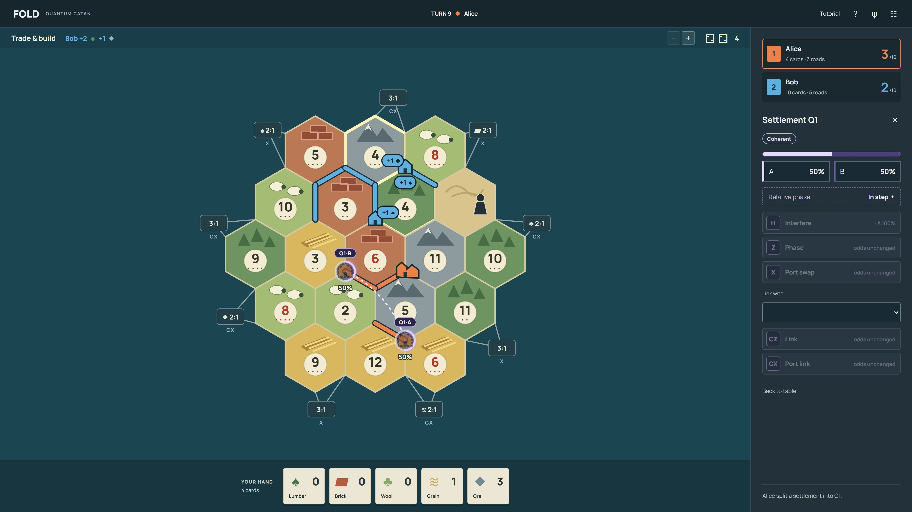

# Fold — Quantum Settlers

A local, pass-and-play Catan-style game for 2–4 people, with settlements that occupy two legal locations until production measures the shared quantum state. Build roads, trade resources and race to ten points; use phase, interference and entanglement to shape where your settlements survive.

**One settlement. Two possible locations. Real quantum gates.**



**Hackathon theme:** Quantum Playground · **License:** MIT · **Node:** Georgia Tech

This effort is supported by Qollab & IonQ

## Start here

- **Players:** run locally below, then choose **Learn by playing** for guided practice.
- **Judges:** read [the quantum model](docs/QUANTUM.md), [architecture and reproduction](docs/ARCHITECTURE.md), and [validation evidence](submissions/VALIDATION.md).
- **Builders:** original source is in `main.js`, `src/`, and `quantum/`; the [architecture guide](docs/ARCHITECTURE.md) explains how to extend it.
- **Submission team:** [requirements and remaining steps](submissions/README.md), [Qollab page copy](submissions/QOLLAB-PROJECT.md), [form answers](submissions/FORM-ANSWERS.md).

**Play:** [fold-kgveritrade.vercel.app](https://fold-kgveritrade.vercel.app) · **Source:** [github.com/Pudging/fold](https://github.com/Pudging/fold)

The public site runs the browser game without signing in. It offers local simulation and Qiskit circuit export; backend verification runs separately inside [the published Qollab project](https://qollab.xyz/u/pudging/fold-quantum-settlers). The demo-video link is still pending. See [deployment and redeployment](docs/DEPLOYMENT.md).

## Why it needs quantum mechanics

A split settlement begins in equal superposition. H makes site A certain; Z followed by H makes site B certain, despite identical initial 50/50 location odds. The phase difference changes interference. CZ can entangle pending settlements without immediately changing individual odds. Joint measurement resolves the board before resource cards are created. These mechanics affect play beyond generating randomness.

The game uses a local exact eight-qubit statevector and exports real Qiskit circuits. Backend verification is separate from live gameplay. Qollab's built-in simulator returned 1,024 shots successfully; free IonQ simulator attempts failed at the provider connection and remain unverified. There is no claim of quantum advantage.

## Run

Node 22.12+:

```sh
npm ci
npm run dev
npm test
node scripts/playthrough.mjs
npm run build
```

Open the localhost address printed by Vite. Choose player names and Start game, or Learn by playing. The tutorial is a separate practice match and restores the real match when you exit. Practice supplies two extra cards of each resource per player after setup; normal matches do not.

### First match

1. Place your two settlements and roads in the guided forward/reverse setup.
2. Roll for production, then trade and build. Offers require the other player to accept.
3. Connect roads to a second legal site. Split a level-one settlement for one ore, or buy a quantum settlement for ordinary settlement resources plus ore.
4. Starting on a later turn, select the pending settlement to interfere, change phase or link it. One gate action per turn; gate ports unlock X/CX.
5. A relevant production roll measures all pending settlements; only surviving sites can produce. First to ten points on their own turn wins.

Open **?** for detailed rules and **ψ** for state/circuit inspection. Controls expose help on hover/focus; mobile players can zoom and scroll the board.

## Implemented foundation

- 19 terrain hexes, 54 intersections, 72 edges, standard resource distribution, dice numbers and nine ports.
- Forward/reverse starting placement, two settlements and two roads each, resources from the second settlement.
- Road connectivity, settlement distance rule, city upgrades, building costs and physical piece limits.
- Dice production for all players, doubled city production, finite bank supply and shortage handling.
- Seven/discard selection, robber movement, blocked production and random theft from a chosen eligible opponent.
- Bank and port trades; player trade offers require the recipient to accept. The UI offers one resource type for another, with adjustable quantities.
- The 25-card development deck: knights, road building, monopoly, year of plenty and victory points. No same-turn play, at most one development card played per turn.
- Longest road with branching/cycles and opponent interruption, largest army, and victory at ten points on your own turn.

Reference: [official CATAN rules](https://www.catan.com/understand-catan/game-rules).

Table conventions: two players is a house variant, without the official neutral-player system. Development actions are taken after rolling in this prototype. Opponents' unplayed victory-point cards are excluded from their displayed score until the end. This is local play on one shared screen, without accounts, networking or saved matches. Competitive balance and long human sessions still need playtesting. This is an independent prototype, not an official CATAN product; artwork is original.

## Quantum modification

A quantum settlement costs one lumber, brick, wool, grain **and ore**. Choose two distance-legal locations connected to your road network. It counts as one settlement piece and one victory point, reserves both sites and their adjacent spacing, and does not allow roads to extend through either pending site.

An existing level-one settlement can also be **split for one ore**, using the same once-per-turn quantum allowance. Its original site becomes A; choose one distance-legal, road-connected destination B. It stays one piece and one point, and previously earned resource cards remain classical. Cities cannot split.

The new settlement starts in equal superposition of location A and location B. Starting on a later turn, its owner may take one quantum action per turn, before or after rolling:

- **Interfere / H:** mix its two complex amplitudes.
- **Phase / Z:** negate the location-B amplitude.
- **Link / CZ:** negate the joint B/B amplitude of this and another pending settlement.
- **Port X:** swap location amplitudes, unlocked by a settlement/city at an X port.
- **Port CX:** controlled-X on another pending settlement, unlocked by a CX port.

Selecting a ghost shows its two locations and current correlations with other pending settlements. Links come from reduced density matrices, not gate history; correlation does not by itself claim bipartite entanglement.

Ordinary trade ratios remain on these ports. Gate rights come from definite buildings, not ghost sites.

When unblocked terrain adjoining either candidate location produces, the entire pending register is measured jointly, then resources are awarded at the surviving locations. Robber contact also measures the register before theft. The first measurement resolves every pending settlement and starts a fresh register for later construction. Up to eight pending settlements share a register.

Resource cards remain classical. The qubit basis is location A/B; terrain determines the resource produced at that location. There is no claim that a single two-dimensional qubit contains four independent resource outcomes.

## Qiskit / Qollab

The browser uses an exact eight-qubit statevector. The board, economy and turns are JavaScript; the quantum circuit is exportable to Qiskit. H/Z/CZ/X/CX are genuine gates, and joint measurement follows the Born rule. Phase-dependent interference and entanglement affect where settlements survive. The game does not claim quantum computational advantage.

`npm run build` produces:
- `dist/`: standalone web build.
- `qollab-build/`: body-only HTML, JS/CSS, Python adapter, requirements and MIT license.

Upload the contents of `qollab-build/` as a Qollab JS/Qiskit project, select the IonQ simulator, and Run. Open **ψ** to inspect the current pending circuit or the last pre-measurement circuit, download Qiskit Python, or submit one 1,024-shot verification job. The result compares backend counts to the captured ideal distribution. Verification does not determine live gameplay outcomes. The backend job stays used across new games/tutorials within that Qollab Run.

The adapter accepts Qollab's injected backend, with no credentials or provider hardcoding. The Python bridge and an eight-qubit H circuit were verified inside Qollab on its built-in simulator. IonQ Aria 1 and Forte 1 simulator attempts failed with a provider-side “Failed to fetch” connection error before returning counts; authenticated IonQ verification remains pending.

## Validation

- Unit tests cover graph topology, setup, resource conservation, building legality, production, robber/discard/theft, trade acceptance, development cards, awards/victory, quantum reservations, phase-dependent location selection, entanglement and gate-port permissions.
- `node scripts/playthrough.mjs` completes three seeded games through ten-point victories using legal game actions and no resource grants, checking card conservation and piece limits throughout.
- `node scripts/verify-qiskit.mjs` compares 80 seeded circuits / 2,000 gates across 3, 6 and 8 qubits against Qiskit Statevector amplitudes and reduced-state purities to 1e-12. It also checks the Python backend adapter against BasicSimulator.
- Browser verification covers guided setup, road construction, player trade acceptance, city upgrade, turn handoff and responsive layout.

For independent Qiskit checks, create `.venv`, install `requirements-dev.txt`, and run `node scripts/verify-qiskit.mjs`; see [platform-specific instructions](docs/ARCHITECTURE.md).

## Attribution and scope

Read [sources, AI assistance and development disclosure](docs/ATTRIBUTION.md). Prior prototype work exists; exact build-window provenance and contributor roles still need team confirmation. Third-party dependencies retain their own licenses. The separate `video/` directory contains a Remotion demo project; its rendered MP4 must be checked independently before submission.

Google Fonts is optional; a sans-serif fallback remains usable. No persistence, accounts or external APIs are needed for local play. Original code and documentation are [MIT licensed](LICENSE).

